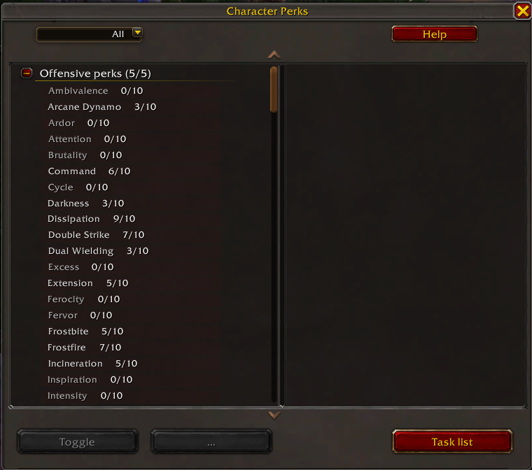
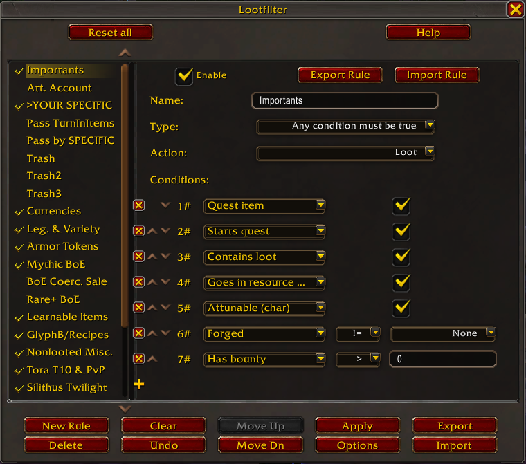
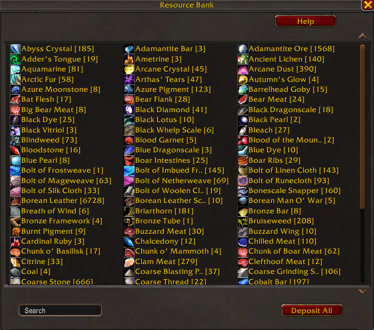
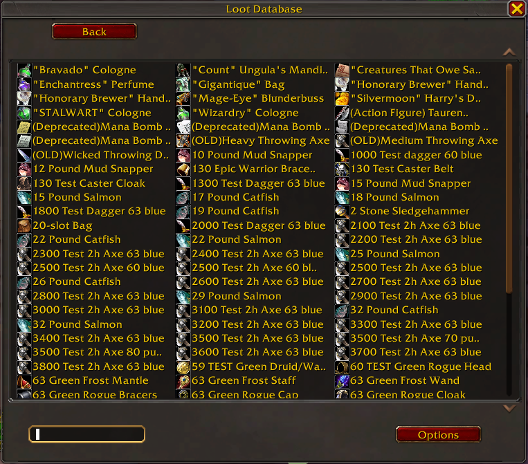
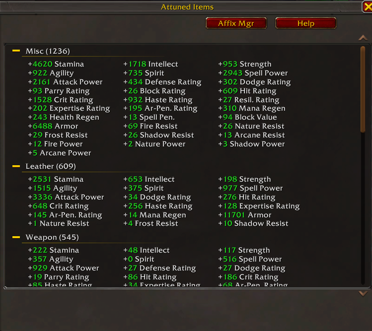
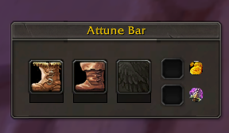
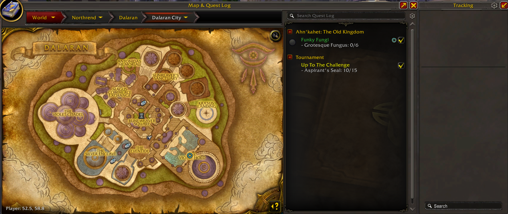
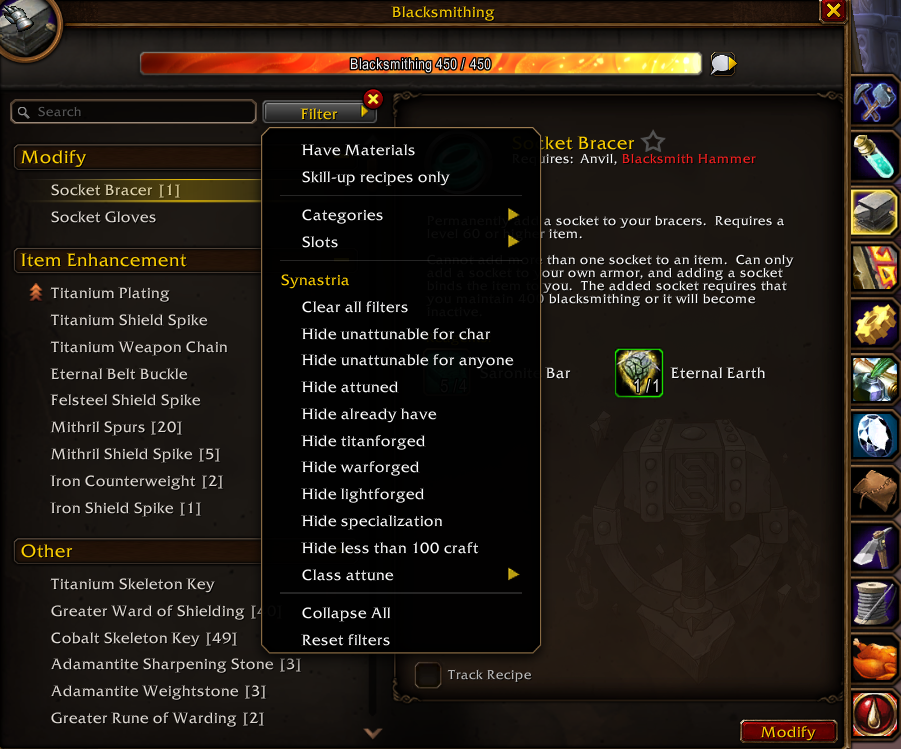

# DragonUI Synastria

A World of Warcraft 3.3.5a addon for the **Synastria** server that fits the server's own UI, and a few
popular Synastria addons, into DragonUI's look.

Everything is switched in DragonUI's settings: **Synastria** tab. `/dsyn` for commands.

## Requirements

- [DragonUI](https://github.com/NeticSoul/DragonUI): this addon builds on it and does nothing without it.

## Features

### Synastria windows

DragonUI frames, buttons, lists, dropdowns and inputs on every server window.

| Character Perks | Lootfilter |
| :---: | :---: |
|  |  |

| Resource Bank | Loot Database |
| :---: | :---: |
|  |  |

| Attuned Items | Attune Bar |
| :---: | :---: |
|  |  |

- Attune Bar on a DragonUI edit-mode mover
- Finder (Tracking) docked to DragonUI's world map
- Item Hunt tracker restyle

- Server profession filters inside DragonUI's professions Filter menu

### Character & tracker

- Synastria section in the character stats (movement speed, attunement, prestige)
- Active perks with open tasks in the quest tracker; Perks / Quests / Achievements sections; scrollable tracker
- Quest log opens DragonUI's Map & Quest Log

### Bags

- Attune bars on items (bags, bank, character panel, guild bank, Bagster), following the server's own settings
- Bagster tabs: Attunable (All / Character / Account) and BoE (All / Attunable)
- Bagster buttons: Deposit materials to the Resource Bank; with ScootsVendor, Sell Scrap runs its auto-sell and
  Never sell / Always sell drop buttons edit its lists

### Synastria extras

- Attune toast in DragonUI's level-up banner style
- All talent specs and multiclass class tabs in DragonUI's talent window
- Stance buttons 11-20 on DragonUI's stance bar, boss frames 5-8 under DragonUI's boss frames

### Optional addon support

Only when the addon is installed:

- DragonUI theme for SynastriaCompanion, Synastria Build Suite and Rotation Assist
- ScootsVendor and ScootsCraft windows, ScootsProgressBar bars

## Install

1. Install [DragonUI](https://github.com/NeticSoul/DragonUI).
2. Download this repository (**Code > Download ZIP**) and unzip it.
3. Copy the inner `DragonUI_Synastria` folder (the one with `DragonUI_Synastria.toc` in it) into
   `Interface\AddOns`, next to `DragonUI`.

## Thanks

- [NeticSoul](https://github.com/NeticSoul) for [DragonUI](https://github.com/NeticSoul/DragonUI)
- [Qt](https://github.com/RosemyneH)
- [Scoots](https://github.com/SynScoots)
- [IExpulsion](https://github.com/iExpulsion)
- Lulleh

## License

[MIT](LICENSE)
